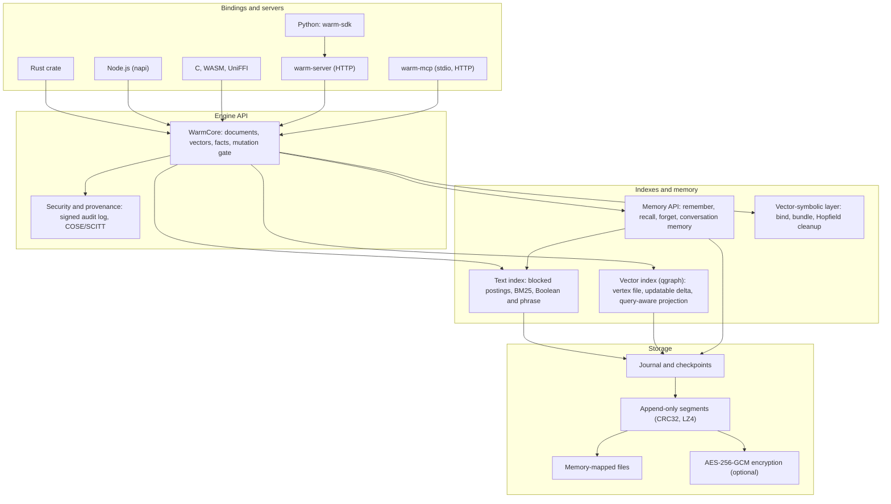

# WARM

**WritersLogic Adaptive Retention & Memory.**

**Hybrid search, graph indexing, and vector-symbolic memory.**

**Local memory for agents and apps: full-text and vector search, a memory API and a vector-symbolic fact store in one embeddable Rust engine that makes no network calls.**

[](https://github.com/writerslogic/warm/actions/workflows/ci.yml)

[](https://securityscorecards.dev/viewer/?uri=github.com/writerslogic/warm)
[](https://www.bestpractices.dev/projects/13977)
[](#license)
[](https://glama.ai/mcp/servers/writerslogic/warm)

[](benchmarks/results/bemula_v1.json)
[](benchmarks/results/longmemeval_official_dev_summary.json)
[](benchmarks/results/query_aware_graph_v1/README.md)

[Website](https://writerslogic.com/warm) ·
[Docs](https://writerslogic.com/warm/docs/) ·
[Get started](#get-started-in-60-seconds) ·
[Standards and provenance](docs/reference/standards.md) ·
[Results](#headline-results) ·
[Capabilities](#what-ships-today) ·
[Limits](#limits) ·
[Contribute](CONTRIBUTING.md)

<br clear="left">

## What it is

WARM is a Rust library that stores text, vectors and facts in a
directory on your machine and finds them again. It ships with Node.js bindings, C, WASM and UniFFI
bindings, an HTTP server with a Python client, and an MCP server. There are no service calls, no
telemetry and no model downloads unless you turn on a feature that asks for one.

| Capability | What you get |
|------------|--------------|
| Document search | Chunking, stemmed BM25 over blocked postings, Boolean and phrase queries, hybrid fusion with embeddings you supply, metadata filters, byte offsets |
| Vector index | Graph index with a memory-mapped vertex file, an updatable delta for inserts and deletes, optional query-aware routing trained on sample queries |
| Memory API | `remember`, `recall`, `forget` and `explain` with time validity and supersession; conversation memory with source provenance |
| Storage | Atomic replace and delete, crash-safe journal and checkpoints, verified compaction, one writer per store |
| Security | Optional AES-256-GCM storage encryption with [documented coverage and limits](docs/SECURITY.md), signed audit log, COSE/SCITT provenance |
| Vector-symbolic layer | Sparse hypervectors with bind, bundle and permute, triples with multi-hop queries, Hopfield cleanup |

## Who it's for

| You are building | What you get |
|------------------|--------------|
| An agent or assistant that needs memory | A memory API with forgetting that removes facts from the store, and an MCP server for editors and agent hosts |
| A local-first or offline app | Embedded search and storage in one directory, with no server process and optional encryption |
| A service that needs vector or text search | `warm-server` over HTTP with tenants and scoped keys, or the library in-process |
| Research on vector-symbolic memory | The bind/bundle algebra, meaning memory and capacity experiments with their result files |

## Headline results

Every row links to the committed file it comes from. These are single machines and stated
protocols, not a substitute for testing your own data.

| Result | Conditions | Source file |
|--------|------------|-------------|
| Bemula forgetting score 0.322; best published row 0.310 (LangMem) | Full split: 50 dialogues, 135 forget requests. Agent and judge both `deepseek-v4-flash-0731` through OpenRouter pinned to DeepSeek, temperature 0; the judge snapshot is inferred from the authors' run metadata. Recall k=5 hybrid with `text-embedding-3-small`. Compared with the paper's published DeepSeek rows; a same-day rerun of the suite's naive RAG baseline scored 0.075. One run. | [`bemula_v1.json`](benchmarks/results/bemula_v1.json) |
| LongMemEval dev 89.75 of 100 correct (mean of 4 runs, range 87 to 93) | Official generation and judge prompts, `gpt-4o-2024-08-06` as reader and judge, top 10 context. Retrieval is the reference turn ranking over cached Qwen3 scores, not native conversation-memory recall. k was chosen on dev; there is no held-out result. | [`longmemeval_official_dev_summary.json`](benchmarks/results/longmemeval_official_dev_summary.json) |
| VIBE llama-128-ip strict recall@100 up to 0.99687 at 1,457 QPS | Official test queries, one thread, query-aware graph (ef=512). Neither frozen RoarGraph configuration reached 0.99. Behind at 0.95 and 0.99 QPS (see below). | [`query_aware_graph_v1/README.md`](benchmarks/results/query_aware_graph_v1/README.md) |
| VIBE yi-128-ip at recall 0.95: 3,214 QPS against 1,953 (MLANN RF80) | Same protocol; compared only with the frozen RoarGraph and MLANN configurations measured there. Recall 0.99 was not reached. | [`query_aware_graph_v1/README.md`](benchmarks/results/query_aware_graph_v1/README.md) |
| SIFT-1M at recall@10 0.95: 23,918 QPS against hnswlib 8,125 (2.94x, interval 2.75 to 3.01); 3.09x at 0.99, 1.40x faster build, 1.83x less serving RSS, 3.74x faster cold start | Core Ultra 9 185H at `4b7a849f`, 10,000 queries issued one at a time from one client thread, index built with 8 threads; WARM through the Rust API, hnswlib through its Python binding; Bonferroni-adjusted bootstrap intervals | [`heavy-ann-sift-...-185h-22c-27g.json`](benchmarks/results/competitive/heavy-ann-sift-128-euclidean-n1000000-linux-x86_64-intel-ultra-9-185h-22c-27g.json) |
| BM25 search on SciFact, NFCorpus and the memory corpus: 1.66x to 2.00x the single-thread QPS of the fastest of tantivy 0.27, Lucene 10.6 and SQLite FTS5, with 1.69x to 2.91x less serving memory and 3.1x to 5.7x faster cold start, at tied nDCG@10 | Two machines (Core Ultra 9 185H at `4b7a849f`, Modal 8 vCPU at `7ba2d4fe`, same engine source), 5 and 3 interleaved serve rounds, Bonferroni-adjusted bootstrap intervals exclude parity for every win. Lexical only, one chunk per document | [COMPARISON.md](docs/benchmarks/COMPARISON.md), [`standard-text-beir-scifact-...-185h-22c-27g.json`](benchmarks/results/competitive/standard-text-beir-scifact-linux-x86_64-intel-ultra-9-185h-22c-27g.json) |
| SciFact nDCG@10 hybrid 0.729, above its own BM25 (0.688) and dense (0.645) | 5,183 documents, 300 queries, MiniLM embeddings supplied by the harness. NFCorpus: 0.355 against 0.323 and 0.317. | [`public_scifact.json`](benchmarks/results/public_scifact.json), [`public_nfcorpus.json`](benchmarks/results/public_nfcorpus.json) |

### Where it's behind

| Result | Conditions | Source file |
|--------|------------|-------------|
| ann-benchmarks at recall 0.95: sift 2,819 QPS against faiss-ivfpqfs 3,788 (0.74x); glove 1,019 against ScaNN 1,535 (0.66x) | Official ann-benchmarks runner, each run pinned to one CPU, AVX2 host | [`ann_benchmarks_harness_wl02_v1.json`](benchmarks/results/ann_benchmarks_harness_wl02_v1.json) |
| VIBE llama-128-ip QPS: 24.6% behind RoarGraph at recall 0.95, 54.8% behind MLANN RF80 at 0.99 | One thread, official test queries | [`query_aware_graph_v1/README.md`](benchmarks/results/query_aware_graph_v1/README.md) |
| SIFT-1M index file 1,389 MiB against hnswlib's 752 (0.54x, no interval); peak build RSS 0.94x of hnswlib's | Same run as the SIFT-1M row above | [`docs/benchmarks/GAPS.md`](docs/benchmarks/GAPS.md) |
| BEIR FiQA (57,600 documents) single-thread BM25 QPS: 1,269 against Lucene 10.6's 1,625 (0.78x); p50 and p99 latency also behind | Core Ultra 9 185H at `4b7a849f`, 5 interleaved serve rounds; serving memory (1.26x less than SQLite FTS5) and cold start (2.37x faster than tantivy) still win | [`standard-text-beir-fiqa-...-185h-22c-27g.json`](benchmarks/results/competitive/standard-text-beir-fiqa-linux-x86_64-intel-ultra-9-185h-22c-27g.json) |
| Text ingest: peak build memory 1.1x to 2.1x SQLite FTS5's on every corpus; ingest time behind SQLite FTS5 on SciFact, NFCorpus and memory (0.46x to 0.97x), tied on FiQA | Same runs, both machines | [`docs/benchmarks/GAPS.md`](docs/benchmarks/GAPS.md) |
| glove-100-angular with the sparse vector path: recall@10 0.252 at 33.7 QPS against FAISS HNSW 0.832 at 4,111 QPS | One thread, Apple M4; the sparse path is experimental | [`public_glove-100-angular.json`](benchmarks/results/public_glove-100-angular.json) |

Method, intervals and every loss: [docs/benchmarks](docs/benchmarks/README.md) and the
[benchmarks pages](https://writerslogic.com/warm/docs/latest/benchmarks/).

<!-- BENCH:START -->

_Generated from `benchmarks/results/competitive/` by `warm-bench table`; method and caveats in [docs/benchmarks/COMPARISON.md](docs/benchmarks/COMPARISON.md). W = WARM ahead (95% interval excludes parity), T = tie, L = a comparator is ahead, - = no verdict (unpinned source revision, no interval, or not comparable). Rows are compared only within one machine._

| Dataset | Machine | Metric | WARM | Best other | Advantage | |
|---|---|---|---|---|---|---|
| sift-128-euclidean | `linux-x86_64-intel-ultra-9-185h-22c-27g` | QPS @ recall@10 >= 0.95 (QPS) | 23,918 | hnswlib 8,125 | 2.94x | W |
| sift-128-euclidean | `linux-x86_64-intel-ultra-9-185h-22c-27g` | p99 latency @ 0.95 (us) | 97 | hnswlib 251 | 2.60x | W |
| sift-128-euclidean | `linux-x86_64-intel-ultra-9-185h-22c-27g` | Build time (s) | 121.44 | hnswlib 170.02 | 1.40x | W |
| sift-128-euclidean | `linux-x86_64-intel-ultra-9-185h-22c-27g` | RSS, serving (MiB) | 490 | hnswlib 898 | 1.83x | W |
| sift-128-euclidean | `linux-x86_64-intel-ultra-9-185h-22c-27g` | Index size (MiB) | 1,389.1 | hnswlib 751.8 | 0.54x | - |
| beir:fiqa | `linux-x86_64-intel-ultra-9-185h-22c-27g` | nDCG@10 | 0.2654 | SQLite FTS5 0.2678 | 0.99x | T |
| beir:fiqa | `linux-x86_64-intel-ultra-9-185h-22c-27g` | QPS (single thread) (QPS) | 1,269 | Apache Lucene 10.6.0 (JVM) 1,625 | 0.78x | L |
| beir:fiqa | `linux-x86_64-intel-ultra-9-185h-22c-27g` | p99 latency (us) | 1,828 | Apache Lucene 10.6.0 (JVM) 1,486 | 0.81x | L |
| beir:fiqa | `linux-x86_64-intel-ultra-9-185h-22c-27g` | Ingest/build time (s) | 1.55 | SQLite FTS5 1.44 | 0.93x | T |
| beir:fiqa | `linux-x86_64-intel-ultra-9-185h-22c-27g` | Peak RSS, serving (MiB) | 31 | SQLite FTS5 39 | 1.26x | W |
| beir:fiqa | `linux-x86_64-intel-ultra-9-185h-22c-27g` | On-disk size (MiB) | 9.7 | Apache Lucene 10.6.0 (JVM) 12.1 | 1.25x | W |
| memory | `modal-x86_64-8vcpu-32g` | nDCG@10 | 0.4561 | Apache Lucene 10.6.0 (JVM) 0.4627 | 0.99x | T |
| memory | `modal-x86_64-8vcpu-32g` | QPS (single thread) (QPS) | 4,138 | tantivy 2,185 | 1.89x | W |
| memory | `modal-x86_64-8vcpu-32g` | p99 latency (us) | 533 | tantivy 798 | 1.50x | W |
| memory | `modal-x86_64-8vcpu-32g` | Ingest/build time (s) | 1.91 | SQLite FTS5 1.75 | 0.92x | L |
| memory | `modal-x86_64-8vcpu-32g` | Peak RSS, serving (MiB) | 17 | SQLite FTS5 41 | 2.42x | W |
| memory | `modal-x86_64-8vcpu-32g` | On-disk size (MiB) | 3.5 | Apache Lucene 10.6.0 (JVM) 10.3 | 2.92x | W |
| memory | `linux-x86_64-intel-ultra-9-185h-22c-27g` | nDCG@10 | 0.4561 | Apache Lucene 10.6.0 (JVM) 0.4627 | 0.99x | T |
| memory | `linux-x86_64-intel-ultra-9-185h-22c-27g` | QPS (single thread) (QPS) | 8,417 | tantivy 4,962 | 1.70x | W |
| memory | `linux-x86_64-intel-ultra-9-185h-22c-27g` | p99 latency (us) | 284 | tantivy 482 | 1.70x | W |
| memory | `linux-x86_64-intel-ultra-9-185h-22c-27g` | Ingest/build time (s) | 0.87 | SQLite FTS5 0.84 | 0.97x | L |
| memory | `linux-x86_64-intel-ultra-9-185h-22c-27g` | Peak RSS, serving (MiB) | 14 | SQLite FTS5 24 | 1.69x | W |
| memory | `linux-x86_64-intel-ultra-9-185h-22c-27g` | On-disk size (MiB) | 3.5 | Apache Lucene 10.6.0 (JVM) 10.3 | 2.92x | W |
| beir:nfcorpus | `modal-x86_64-8vcpu-32g` | nDCG@10 | 0.2916 | SQLite FTS5 0.2914 | 1.00x | T |
| beir:nfcorpus | `modal-x86_64-8vcpu-32g` | QPS (single thread) (QPS) | 12,373 | tantivy 7,333 | 1.69x | W |
| beir:nfcorpus | `modal-x86_64-8vcpu-32g` | p99 latency (us) | 164 | tantivy 280 | 1.71x | W |
| beir:nfcorpus | `modal-x86_64-8vcpu-32g` | Ingest/build time (s) | 0.44 | SQLite FTS5 0.20 | 0.46x | L |
| beir:nfcorpus | `modal-x86_64-8vcpu-32g` | Peak RSS, serving (MiB) | 15 | SQLite FTS5 45 | 2.91x | W |
| beir:nfcorpus | `modal-x86_64-8vcpu-32g` | On-disk size (MiB) | 1.0 | Apache Lucene 10.6.0 (JVM) 1.5 | 1.55x | W |
| beir:nfcorpus | `linux-x86_64-intel-ultra-9-185h-22c-27g` | nDCG@10 | 0.2916 | SQLite FTS5 0.2914 | 1.00x | T |
| beir:nfcorpus | `linux-x86_64-intel-ultra-9-185h-22c-27g` | QPS (single thread) (QPS) | 23,585 | tantivy 14,207 | 1.66x | W |
| beir:nfcorpus | `linux-x86_64-intel-ultra-9-185h-22c-27g` | p99 latency (us) | 153 | tantivy 245 | 1.60x | W |
| beir:nfcorpus | `linux-x86_64-intel-ultra-9-185h-22c-27g` | Ingest/build time (s) | 0.15 | SQLite FTS5 0.14 | 0.94x | L |
| beir:nfcorpus | `linux-x86_64-intel-ultra-9-185h-22c-27g` | Peak RSS, serving (MiB) | 13 | SQLite FTS5 28 | 2.22x | W |
| beir:nfcorpus | `linux-x86_64-intel-ultra-9-185h-22c-27g` | On-disk size (MiB) | 1.0 | Apache Lucene 10.6.0 (JVM) 1.5 | 1.55x | W |
| beir:scifact | `modal-x86_64-8vcpu-32g` | nDCG@10 | 0.7027 | Apache Lucene 10.6.0 (JVM) 0.7022 | 1.00x | T |
| beir:scifact | `modal-x86_64-8vcpu-32g` | QPS (single thread) (QPS) | 5,534 | tantivy 3,106 | 1.78x | W |
| beir:scifact | `modal-x86_64-8vcpu-32g` | p99 latency (us) | 236 | tantivy 474 | 2.01x | W |
| beir:scifact | `modal-x86_64-8vcpu-32g` | Ingest/build time (s) | 0.58 | SQLite FTS5 0.30 | 0.52x | L |
| beir:scifact | `modal-x86_64-8vcpu-32g` | Peak RSS, serving (MiB) | 31 | SQLite FTS5 70 | 2.23x | W |
| beir:scifact | `modal-x86_64-8vcpu-32g` | On-disk size (MiB) | 1.3 | Apache Lucene 10.6.0 (JVM) 2.0 | 1.53x | W |
| beir:scifact | `linux-x86_64-intel-ultra-9-185h-22c-27g` | nDCG@10 | 0.7027 | Apache Lucene 10.6.0 (JVM) 0.7022 | 1.00x | T |
| beir:scifact | `linux-x86_64-intel-ultra-9-185h-22c-27g` | QPS (single thread) (QPS) | 12,254 | tantivy 6,133 | 2.00x | W |
| beir:scifact | `linux-x86_64-intel-ultra-9-185h-22c-27g` | p99 latency (us) | 220 | tantivy 402 | 1.83x | W |
| beir:scifact | `linux-x86_64-intel-ultra-9-185h-22c-27g` | Ingest/build time (s) | 0.22 | SQLite FTS5 0.20 | 0.91x | L |
| beir:scifact | `linux-x86_64-intel-ultra-9-185h-22c-27g` | Peak RSS, serving (MiB) | 29 | SQLite FTS5 53 | 1.84x | W |
| beir:scifact | `linux-x86_64-intel-ultra-9-185h-22c-27g` | On-disk size (MiB) | 1.3 | Apache Lucene 10.6.0 (JVM) 2.0 | 1.53x | W |

<!-- BENCH:END -->

## Get started

Clone once: `git clone https://github.com/writerslogic/warm && cd warm`.
Run the offline agent-memory demo with `cargo run --release --example demo-offline-agent`.

<details open>
<summary><strong>Rust</strong></summary>

From your own Rust project, add the current Apache-2.0 source:

```sh
cargo add warm-rust
```

The historical [v0.6.1 source](https://github.com/writerslogic/warm/tree/v0.6.1)
remains AGPL-3.0-or-later; it is available from that Git tag, not as a
`warm-rust` 0.6.1 release on crates.io.

```rust quickstart-check
use writerslogic_warm::{DocumentInput, WarmCore, SearchOptions};

let dir = tempfile::tempdir()?;
let warm = WarmCore::new(4096, Some(dir.path().display().to_string()), None)?;
warm.memorize_document(DocumentInput {
    id: "backups".into(),
    text: "Restore deleted documents from verified backups.".into(),
    source_uri: Some("operations.md".into()),
    version: Some("1".into()),
    metadata: Some(serde_json::json!({ "project": "alpha" })),
    chunk_words: None, overlap_words: None, store_text: None, embeddings: None, title_weight: None,
})?;
let hits = warm.search_documents("restore backups", &SearchOptions::default())?;
println!("{} {:?}", hits[0].document_id, hits[0].source_uri);
```

Unreleased Rust API change: `WarmCore::query`, `query_batch`, and
`analyze_components` return `Result`. Handle the result with `?` or an explicit
error branch; deferred-encoding failures no longer become successful partial
query results. `get_document`, `list_documents`, `get_document_info`, and `list_document_info`
also return `Result`; retained-text and checkpoint decoding failures propagate
instead of panicking, and reads no longer hydrate the
entire checkpoint or hold store locks during text I/O.

</details>

<details>
<summary><strong>Node.js</strong></summary>

Install the Node.js package and its platform-specific native binary:

```sh
npm install warm-sdk
```

To build from source, run `npm ci --omit=optional && npm run build` with Rust installed.
The WARM release includes `listDocuments` for scoped pruning. See the
[integration guide](docs/integrations/organizational-knowledge.md) for source
provenance, namespace isolation, dry runs and deletion limits.

```js quickstart-check
const { WarmMemorySystem } = require('warm-sdk')
const { DocumentMemory } = require('warm-sdk/semantic')

async function main() {
  const dir = require('node:fs').mkdtempSync(require('node:path').join(require('node:os').tmpdir(), 'warm-readme-'))
  const memory = new DocumentMemory(new WarmMemorySystem(4096, dir))
  await memory.memorize({
    id: 'backups', text: 'Restore deleted documents from verified backups.',
    sourceUri: 'operations.md', version: '1', metadata: { project: 'alpha' },
  })
  const [hit] = await memory.search('restore backups', { filter: { project: 'alpha' } })
  console.log(hit.documentId, hit.sourceUri, hit.text)
  await memory.flush()
}
main().catch(error => { console.error(error); process.exit(1) })
```

</details>

<details>
<summary><strong>Server and Python</strong></summary>

The Python package `warm-sdk` is an HTTP client for `warm-server`, which stores vectors you
supply. (`warm-python` provides native vector search and phase vectors, but no document search.)

```sh
cargo build --release --features server --bin warm-server
WARM_API_KEY=change-me target/release/warm-server --input-dim 384 &
uv pip install warm-sdk
```

```python
from writerslogic_warm_sdk import WarmClient

client = WarmClient(url="http://127.0.0.1:8080", api_key="change-me", tenant_id="demo")
client.add_documents([{"id": "a", "vector": [0.1] * 384, "text": "hello", "metadata": {}}])
print(client.query([0.1] * 384, top_k=1)["matches"][0]["id"])
```

Endpoints, flags, tenants and limits are in the
[server docs](https://writerslogic.com/warm/docs/latest/server/). A runnable Python quickstart
with a toy embedder is in [`examples/quickstart/python`](examples/quickstart/python/quickstart.py).

</details>

<details>
<summary><strong>MCP</strong></summary>

`warm-mcp` serves a store to any Model Context Protocol client over stdio or HTTP:

```sh
npx -y writerslogic-warm-mcp                                # stdio; downloads a verified binary on first run
npx -y writerslogic-warm-mcp --transport http               # http://127.0.0.1:8765/mcp
```

The [MCP package](https://www.npmjs.com/package/writerslogic-warm-mcp) is a separate launcher. To build the server from source:

```sh
cargo build --release --features mcp,security --bin warm-mcp   # add local-models for semantic recall
./target/release/warm-mcp                                       # stdio
./target/release/warm-mcp --transport http                      # http://127.0.0.1:8765/mcp
```

Client setup, data directory and the one-writer rule: [MCP integration](docs/integrations/mcp/README.md).

For normalized content from multiple applications, see the [organizational knowledge adapter](docs/integrations/organizational-knowledge.md).

</details>

The [five-minute quickstart](https://writerslogic.com/warm/docs/latest/quickstart/)
walks through ingest, search, a SQLite FTS5 comparison and encryption in Rust, Python and Node,
and CI runs that code on every pull request. For a whole agent memory with no embeddings and no
network, run `cargo run --example demo-offline-agent`.

## What ships today

| Capability | Status | Documented limit |
|------------|--------|------------------|
| Hybrid document search (BM25 + exact cosine, filters, byte offsets) | Ships | Exact scan of eligible chunks; benchmark your corpus before assuming capacity ([guide](docs/production-readiness.md)) |
| Boolean lexical search (`+required`, `-excluded`, quoted phrases) | Ships | Flat queries only, no nesting; an empty or only-excluded query matches nothing ([design](docs/benchmarks/lexical/DESIGN.md)) |
| Atomic replace/delete, crash-safe journal, verified compaction, process lock | Ships | One writer per store; compaction is not secure erasure |
| Vector index (`qgraph` vertex graph, memory-mapped) | Ships | Build time and serving RSS behind hnswlib on SIFT-1M ([gaps](docs/benchmarks/GAPS.md)) |
| Updatable vector index (durable delta for inserts and deletes) | Ships | Single writer; format in [VECTOR-UPDATES.md](docs/file-format/VECTOR-UPDATES.md) |
| Query-aware graph routing (trained on sample queries) | Ships (opt-in) | Needs representative training queries; tested on VIBE llama and yi ([report](benchmarks/results/query_aware_graph_v1/README.md)) |
| Memory API: remember, recall, forget, explain | Ships | Forgetting removes a fact from the store; it does not cover what a model inferred ([docs](docs/memory-api/README.md)) |
| Conversation memory (`conversation-memory`) | Ships | Bounded context with exact source provenance; native recall not yet benchmarked on LongMemEval end to end |
| Meaning memory: triples, multi-hop, Hopfield cleanup | Ships (runtime opt-in) | Tested on synthetic and 2,120-fact sets ([`research_bench_16384_256.json`](benchmarks/results/research_bench_16384_256.json)) |
| Union-bundle membership (`experimental`) | Research | At D = 16,384: positive gap to N = 500 (4% false positives), tested to 2,500 ([`benchmark_scaling_results.json`](benchmarks/results/benchmark_scaling_results.json)) |
| Sparse vector index (`memorize_vector`) | Experimental | Not competitive with HNSW ([results](#where-its-behind)) |
| Encrypted stores (`security`) | Ships | AES-256-GCM, Argon2id; covers the log, index caches and the text segment. Metadata, file names and sizes are not encrypted |
| Signed audit log, credential-gated access, COSE/SCITT/C2PA (`provenance`) | Ships | Host must authenticate DIDs; PoSME, RATS, `did:web` not implemented |
| On-device models (`local-models`: Qwen3 embed/rerank/LLM) | Ships | Local weights only; never downloads |
| `warm-server` HTTP API, multi-tenant (`server`) | Ships | Single node; TLS, per-tenant scoped keys ([guide](docs/SERVER.md)) |
| MCP server (`mcp`: `warm-mcp`, stdio and HTTP) | Ships | Encryption needs `security`; semantic recall needs `local-models` |
| Node.js bindings | Ships on npm and from source | Native binaries are selected by platform at install time |
| C, Go, .NET, Java, Kotlin, Swift and WebAssembly bindings | Source available | Require local builds; the language packages and native bundles are not yet published ([runtime guides](docs/runtimes)) |
| Python | Client + phase substrate | No in-process document search |
| Query-private search (`private-search`) | Experimental | For searching an index someone else holds; hides the query vector from the scorer only ([notes](docs/PRIVATE-SEARCH.md)) |

Every capability above except document search and the vector index is behind a Cargo feature or
runtime option that is off by default; [Cargo features](docs/reference/features.md) lists them all.

## Architecture



Module map: [docs/ARCHITECTURE.md](docs/ARCHITECTURE.md).

## Limits

- **Not anonymous.** Hypervector sketches and term counts are not encryption; anyone with a store
  can encode candidate text and compare. `storeText: false` keeps term counts, IDs and
  embeddings, so it is not a privacy control.
- **Document search is conventional.** It does not use the hypervectors; the holographic parts
  are the algebra and the meaning memory.
- **One writer per store.** A second writing process fails at open with a lock error.
- **Capacity numbers are points, not guarantees**, and are stated only over the tested range
  ([capacity](https://writerslogic.com/warm/docs/latest/concepts/capacity/)).
- **Benchmark results are single machines.** Conditions are in each results file; the single-core
  ann-benchmarks run and the VIBE high-recall points are losses (see [Where it's behind](#where-its-behind)).
- **Masking is obfuscation.** Client-side vector masking preserves every pairwise similarity.
- A store is a directory and `WarmCore::new(.., None, ..)` uses the current directory.

Full statement: [docs/PRIVACY.md](docs/PRIVACY.md). Report vulnerabilities privately via
[SECURITY.md](SECURITY.md).

## Contributing

[CONTRIBUTING.md](CONTRIBUTING.md): setup, the checks CI runs, DCO sign-off (`git commit -s`, no
CLA). Start with a [good first issue](https://github.com/writerslogic/warm/labels/good%20first%20issue)
or [Discussions](https://github.com/writerslogic/warm/discussions). See the
[Code of Conduct](CODE_OF_CONDUCT.md). Benchmark changes regenerate the results file they touch;
the README cites files, not remembered figures.

## License

Apache-2.0. See [LICENSE](LICENSE). Use, modify and embed it in open-source or proprietary software, including network services, with no copyleft obligation. The historical [v0.6.1 source](https://github.com/writerslogic/warm/tree/v0.6.1) remains available under its [AGPL-3.0-or-later license](https://github.com/writerslogic/warm/blob/v0.6.1/LICENSE).
