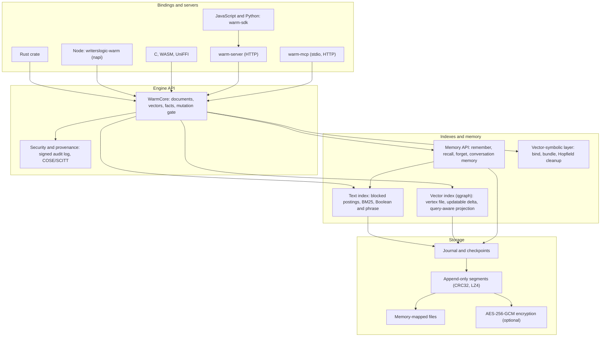

# WARM

**Local memory for AI agents and applications.**

WARM (WritersLogic Adaptive Retention & Memory) gives agents persistent memory, full-text and
vector search, and source provenance in one embeddable Rust engine. Use it inside your application,
through HTTP, or from an MCP client, with storage on infrastructure you control.

[](https://github.com/writerslogic/warm/actions/workflows/ci.yml)

[](https://securityscorecards.dev/viewer/?uri=github.com/writerslogic/warm)
[](https://www.bestpractices.dev/projects/13977)
[](#license)
[](https://glama.ai/mcp/servers/writerslogic/warm)


[Website](https://writerslogic.com/warm) ·
[Docs](https://writerslogic.com/warm/docs/) ·
[Get started](#get-started) ·
[Standards and provenance](docs/reference/standards.md) ·
[Evaluation](#evaluation) ·
[Capabilities](#what-ships-today) ·
[Limits](#limits) ·
[Contribute](CONTRIBUTING.md)

<br clear="left">

## What it is

WARM is a Rust library that stores text, vectors and facts in a
directory on your machine and finds them again. It ships with optional Node.js, C, WASM and UniFFI
bindings, an HTTP server with portable JavaScript and Python clients, and an MCP server.
The embedded engine makes no service calls or telemetry requests. HTTP clients connect to the
server you configure; model stages are opt-in.

| Capability | What you get |
|------------|--------------|
| Document search | Chunking, stemmed BM25 over blocked postings, Boolean and phrase queries, hybrid fusion with embeddings you supply, metadata filters, byte offsets |
| Vector index | Graph index with a memory-mapped vertex file, an updatable delta for inserts and deletes, optional query-aware routing trained on sample queries |
| Memory API | `remember`, `recall`, `forget` and `explain` with time validity and supersession; conversation memory with source provenance |
| Storage | Atomic replace and delete, crash-safe journal and checkpoints, verified compaction, one writer per store |
| Security | Optional AES-256-GCM storage encryption with [documented coverage and limits](docs/SECURITY.md), signed audit log, COSE/SCITT provenance |
| Vector-symbolic layer | Sparse hypervectors with bind, bundle and permute, triples with multi-hop queries, Hopfield cleanup |

## Who it's for

| You are building | What you get |
|------------------|--------------|
| An agent or assistant that needs memory | A memory API with forgetting that removes facts from the store, and an MCP server for editors and agent hosts |
| A local-first or offline app | Embedded search and storage in one directory, with no server process and optional encryption |
| A service that needs vector or text search | `warm-server` over HTTP with tenants and scoped keys, or the library in-process |

## Get started

For an editor or agent host, start with the [MCP integration](docs/integrations/mcp/README.md).
For an application, choose the Rust library or HTTP server below. WARM runs locally or on your
own infrastructure; this repository does not provide a managed cloud service.

To try the offline memory demo from source:

```sh
git clone https://github.com/writerslogic/warm
cd warm
cargo run --release --example demo-offline-agent
```

<details open>
<summary><strong>Rust</strong></summary>

From your own Rust project, add the current Apache-2.0 source. The crate is `warm-rust`; the library is imported as `writerslogic_warm`. The MSRV is Rust 1.89; `local-models` and `--all-features` need Rust 1.94 or newer.

```sh
cargo add warm-rust
```

The historical [v0.6.1 source](https://github.com/writerslogic/warm/tree/v0.6.1)
remains AGPL-3.0-or-later; it is available from that Git tag, not as a
`warm-rust` 0.6.1 release on crates.io.

```rust quickstart-check
use writerslogic_warm::{DocumentInput, WarmCore, SearchOptions};

let dir = tempfile::tempdir()?;
let warm = WarmCore::new(4096, Some(dir.path().display().to_string()), None)?;
warm.memorize_document(DocumentInput {
    id: "backups".into(),
    text: "Restore deleted documents from verified backups.".into(),
    source_uri: Some("operations.md".into()),
    version: Some("1".into()),
    metadata: Some(serde_json::json!({ "project": "alpha" })),
    chunk_words: None, overlap_words: None, store_text: None, embeddings: None, title_weight: None,
})?;
let hits = warm.search_documents("restore backups", &SearchOptions::default())?;
println!("{} {:?}", hits[0].document_id, hits[0].source_uri);
```

Rust API change in 0.6.6 (0.6.5 returns these values directly): `WarmCore::query`, `query_batch`, and
`analyze_components` return `Result`. Handle the result with `?` or an explicit
error branch; deferred-encoding failures no longer become successful partial
query results. `get_document`, `list_documents`, `get_document_info`, and `list_document_info`
also return `Result`; retained-text and checkpoint decoding failures propagate
instead of panicking, and reads no longer hydrate the
entire checkpoint or hold store locks during text I/O.

</details>

<details>
<summary><strong>JavaScript and TypeScript: portable client</strong></summary>

`warm-sdk` 0.2.1 is the portable HTTP client for a separately running `warm-server`.
It has no native binaries or runtime dependencies and uses standard Fetch and Web Streams APIs
(Node 18 or newer). Installing or importing it does not load the embedded engine or download models.
For a published release, install the client in your application:

```sh
npm install warm-sdk@0.2.1
```

Check the [available npm versions](https://www.npmjs.com/package/warm-sdk?activeTab=versions).
To build the client from this checkout:

```sh
npm ci --prefix bindings/js/warm-sdk
npm run build --prefix bindings/js/warm-sdk
```

In your application, install that directory with
`npm install /absolute/path/to/warm/bindings/js/warm-sdk`.

Start the server in a separate terminal:

```sh
cargo build --release --features server --bin warm-server
WARM_API_KEY=change-me target/release/warm-server --input-dim 384
```

```js
import { WarmClient } from 'warm-sdk'

const warm = new WarmClient({
  url: process.env.WARM_URL ?? 'http://127.0.0.1:8080',
  apiKey: process.env.WARM_API_KEY, tenantId: 'demo',
})
await warm.memory.remember('Restore deleted documents from verified backups.', {
  id: 'backups', metadata: { project: 'alpha' },
})
const hits = await warm.memory.recall('restore backups', { filter: { project: 'alpha' } })
console.log(hits[0]?.text)
```

Set `WARM_API_KEY` to the server's key before running the client. This memory example uses
lexical retrieval and needs no embedding model. A runnable source example also checks retrieval
and deletion in an isolated namespace:

```sh
WARM_URL=http://127.0.0.1:8080 WARM_API_KEY=change-me \
  node examples/quickstart/js-client/quickstart.mjs
```

See the [client API](bindings/js/warm-sdk/README.md) and
[release availability](docs/RELEASING.md#javascript-package-availability).
Browser deployments must permit the application's origin at the HTTP service boundary.

</details>

<details>
<summary><strong>Node.js: optional embedded engine</strong></summary>

`writerslogic-warm` embeds the Rust engine in Node. For a published engine release,
install it explicitly with npm's optional dependencies enabled:

```sh
npm install writerslogic-warm@0.6.8
```

Check the [available npm versions](https://www.npmjs.com/package/writerslogic-warm?activeTab=versions).
To build from the cloned repository, with Rust installed:

```sh
npm ci --omit=optional
npm run build
```

The portable client and embedded engine are separate packages with different APIs.
`listDocuments` supports scoped pruning. See the
[integration guide](docs/integrations/organizational-knowledge.md) for source
provenance, namespace isolation, dry runs and deletion limits.

```js quickstart-check
const { WarmMemorySystem } = require('writerslogic-warm')
const { DocumentMemory } = require('writerslogic-warm/semantic')

async function main() {
  const dir = require('node:fs').mkdtempSync(require('node:path').join(require('node:os').tmpdir(), 'warm-readme-'))
  const memory = new DocumentMemory(new WarmMemorySystem(4096, dir))
  await memory.memorize({
    id: 'backups', text: 'Restore deleted documents from verified backups.',
    sourceUri: 'operations.md', version: '1', metadata: { project: 'alpha' },
  })
  const [hit] = await memory.search('restore backups', { filter: { project: 'alpha' } })
  console.log(hit.documentId, hit.sourceUri, hit.text)
  await memory.flush()
}
main().catch(error => { console.error(error); process.exit(1) })
```

</details>

<details>
<summary><strong>Server and Python</strong></summary>

The Python package `warm-sdk` is an HTTP client for `warm-server`, which stores vectors you
supply. (`warm-python`, imported as `writerslogic_warm`, provides native vector indexes and phase vectors, but no document search.)

```sh
cargo build --release --features server --bin warm-server
WARM_API_KEY=change-me target/release/warm-server --input-dim 384 &
uv pip install warm-sdk
```

```python
from writerslogic_warm_sdk import WarmClient

client = WarmClient(url="http://127.0.0.1:8080", api_key="change-me", tenant_id="demo")
client.add_documents([{"id": "a", "vector": [0.1] * 384, "text": "hello", "metadata": {}}])
print(client.query([0.1] * 384, top_k=1)["matches"][0]["id"])
```

Endpoints, flags, tenants and limits are in the
[server docs](https://writerslogic.com/warm/docs/latest/server/). A runnable Python quickstart
with a toy embedder is in [`examples/quickstart/python`](examples/quickstart/python/quickstart.py).

</details>

<details>
<summary><strong>MCP</strong></summary>

`warm-mcp` serves a store to any Model Context Protocol client over stdio or HTTP:

```sh
npx -y writerslogic-warm-mcp                                # stdio; downloads a verified binary on first run
npx -y writerslogic-warm-mcp --transport http               # http://127.0.0.1:8765/mcp
```

The [MCP package](https://www.npmjs.com/package/writerslogic-warm-mcp) is a separate launcher. To build the server from source:

```sh
cargo build --release --features mcp,security --bin warm-mcp   # add local-models for semantic recall
./target/release/warm-mcp                                       # stdio
./target/release/warm-mcp --transport http                      # http://127.0.0.1:8765/mcp
```

Client setup, data directory and the one-writer rule: [MCP integration](docs/integrations/mcp/README.md).

For normalized content from multiple applications, see the [organizational knowledge adapter](docs/integrations/organizational-knowledge.md).

</details>

The [five-minute quickstart](https://writerslogic.com/warm/docs/latest/quickstart/)
walks through ingest, search, a SQLite FTS5 comparison and encryption in Rust, Python and Node,
and CI runs that code on every pull request. For a whole agent memory with no embeddings and no
network, run `cargo run --example demo-offline-agent`.

<a id="headline-results"></a>
<a id="where-its-behind"></a>

## Evaluation

[Recorded results and limitations](docs/benchmarks/EVALUATION.md) cover memory quality, text
retrieval and vector search. Each result retains its workload, hardware, model, source revision
and known losses. The [full comparison and reproduction protocol](docs/benchmarks/README.md)
provide the evidence for evaluating WARM on your own workload.

## What ships today

| Capability | Status | Documented limit |
|------------|--------|------------------|
| Hybrid document search (BM25 + exact cosine, filters, byte offsets) | Ships | Exact scan of eligible chunks; benchmark your corpus before assuming capacity ([guide](docs/production-readiness.md)) |
| Boolean lexical search (`+required`, `-excluded`, quoted phrases) | Ships | Flat queries only, no nesting; an empty or only-excluded query matches nothing ([design](docs/benchmarks/lexical/DESIGN.md)) |
| Atomic replace/delete, crash-safe journal, verified compaction, process lock | Ships | One writer per store; compaction is not secure erasure |
| Vector index (`qgraph` vertex graph, memory-mapped) | Ships | Build time and serving RSS behind hnswlib on SIFT-1M ([gaps](docs/benchmarks/GAPS.md)) |
| Updatable vector index (durable delta for inserts and deletes) | Ships | Single writer; format in [VECTOR-UPDATES.md](docs/file-format/VECTOR-UPDATES.md) |
| Query-aware graph routing (trained on sample queries) | Ships (opt-in) | Needs representative training queries; tested on VIBE llama and yi ([report](benchmarks/results/query_aware_graph_v1/README.md)) |
| Memory API: remember, recall, forget, explain | Ships | Forgetting removes a fact from the store; it does not cover what a model inferred ([docs](docs/memory-api/README.md)) |
| Conversation memory (`conversation-memory`) | Ships | Bounded context with exact source provenance; native recall not yet benchmarked on LongMemEval end to end |
| Meaning memory: triples, multi-hop, Hopfield cleanup | Ships (runtime opt-in) | Tested on synthetic and 2,120-fact sets ([`research_bench_16384_256.json`](benchmarks/results/research_bench_16384_256.json)) |
| Union-bundle membership (`experimental`) | Research | At D = 16,384: positive gap to N = 500 (4% false positives), tested to 2,500 ([`benchmark_scaling_results.json`](benchmarks/results/benchmark_scaling_results.json)) |
| Sparse vector index (`memorize_vector`) | Experimental | Not competitive with HNSW ([results](docs/benchmarks/EVALUATION.md#where-its-behind)) |
| Encrypted stores (`security`) | Ships | AES-256-GCM, Argon2id; covers the log, index caches and the text segment. Metadata, file names and sizes are not encrypted |
| Signed audit log, credential-gated access, COSE/SCITT/C2PA (`provenance`) | Ships | Host must authenticate DIDs; PoSME, RATS, `did:web` not implemented |
| On-device models (`local-models`: Qwen3 embed/rerank/LLM) | Ships | Local weights only; never downloads |
| `warm-server` HTTP API, multi-tenant (`server`) | Ships | Single node; TLS, per-tenant scoped keys ([guide](docs/SERVER.md)) |
| MCP server (`mcp`: `warm-mcp`, stdio and HTTP) | Ships | Encryption needs `security`; semantic recall needs `local-models` |
| JavaScript/TypeScript client (`warm-sdk` 0.2.1) | Source and release builds | Portable HTTP client; requires a separately running server |
| Embedded Node.js (`writerslogic-warm` 0.6.8) | Source and release builds | Eight optional native platform packages; separate from the client |
| C, Go, .NET, Java, Kotlin, Swift and WebAssembly bindings | Source available | Require local builds; the language packages and native bundles are not yet published ([runtime guides](docs/runtimes)) |
| Python | HTTP client (`warm-sdk`); native vector indexes and phase vectors (`warm-python`) | No in-process document search |
| Query-private search (`private-search`) | Experimental | For searching an index someone else holds; hides the query vector from the scorer only ([notes](docs/PRIVATE-SEARCH.md)) |

Optional engine capabilities use Cargo features or runtime configuration;
[Cargo features](docs/reference/features.md) lists the build choices.

The [compatibility policy](docs/STABILITY.md) defines API stability, deprecation windows and
storage-format migration rules.

## Architecture



Module map: [docs/ARCHITECTURE.md](docs/ARCHITECTURE.md).

## Limits

- **Not anonymous.** Hypervector sketches and term counts are not encryption; anyone with a store
  can encode candidate text and compare. `storeText: false` keeps term counts, IDs and
  embeddings, so it is not a privacy control.
- **Document search is conventional.** It does not use the hypervectors; the holographic parts
  are the algebra and the meaning memory.
- **One writer per store.** A second writing process fails at open with a lock error.
- **Capacity numbers are points, not guarantees**, and are stated only over the tested range
  ([capacity](https://writerslogic.com/warm/docs/latest/concepts/capacity/)).
- **Benchmark results are single machines.** Conditions are in each results file; the single-core
  ann-benchmarks run and the VIBE high-recall points are losses (see [Where it's behind](docs/benchmarks/EVALUATION.md#where-its-behind)).
- **Masking is obfuscation.** Client-side vector masking preserves every pairwise similarity.
- A store is a directory and `WarmCore::new(.., None, ..)` uses the current directory.

Full statement: [docs/PRIVACY.md](docs/PRIVACY.md). Report vulnerabilities privately via
[SECURITY.md](SECURITY.md).

## Contributing

[CONTRIBUTING.md](CONTRIBUTING.md): setup, the checks CI runs, DCO sign-off (`git commit -s`, no
CLA). Start with a [good first issue](https://github.com/writerslogic/warm/labels/good%20first%20issue)
or [Discussions](https://github.com/writerslogic/warm/discussions). See the
[Code of Conduct](CODE_OF_CONDUCT.md). Benchmark changes regenerate the results file they touch;
the README cites files, not remembered figures.

## License

Apache-2.0. See [LICENSE](LICENSE). Use, modify and embed it in open-source or proprietary software, including network services, with no copyleft obligation. The historical [v0.6.1 source](https://github.com/writerslogic/warm/tree/v0.6.1) remains available under its [AGPL-3.0-or-later license](https://github.com/writerslogic/warm/blob/v0.6.1/LICENSE).
